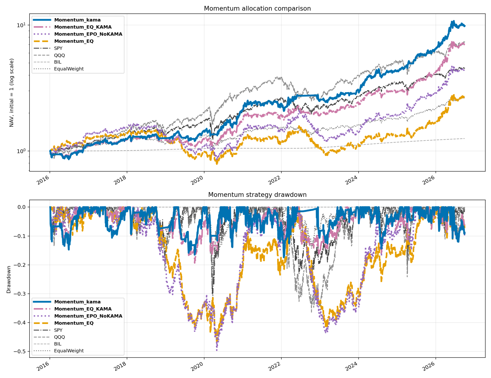

# ETF Momentum, KAMA and EPO Backtest

A reproducible research prototype for monthly multi-asset ETF rotation. The strategy ranks ETFs using regression momentum, optionally filters candidates with Kaufman's Adaptive Moving Average (KAMA), and allocates across up to three selected ETFs using either equal weights or an anchored EPO rule.

The current version runs a clean **2 × 2 comparison**:

- equal-weight allocation versus EPO allocation;
- without KAMA filtering versus with KAMA filtering.

The backtest includes transaction costs, cash interest, financing assumptions, self-financing portfolio accounting, zero-cost counterfactuals, drawdown analysis, and both absolute and benchmark-relative asset attribution.

> This repository contains research code, not a live trading system. Historical results depend on the selected universe, parameters, data quality, and execution assumptions.

## Strategy overview

### 1. Regression momentum

For every ETF, the strategy fits a linear trend to log adjusted closing prices over each configured momentum window. The single-window score is

```text
momentum score = expm1(250 × regression slope) × R²
```

The default window contains **34 closing prices**. The slope measures the direction and speed of the trend, while `R²` rewards trends that have been relatively smooth and consistent.

When several windows are supplied, each window is ranked separately and the average rank determines the final order. A strict majority of the window scores must be positive for an ETF to remain eligible.

### 2. Optional KAMA filter

For the two KAMA variants, an ETF is eligible only when:

- the fast KAMA is above the slow KAMA; and
- the fast KAMA has risen over the previous `KAMA_DIFF_DAYS` trading days.

`USE_KAMA_FILTER` is the master KAMA switch. When it is `False`, the two KAMA-labelled strategies intentionally coincide with their corresponding no-KAMA controls.

### 3. Selection and defensive fallback

At each rebalance, the strategy selects up to `TOP_N = 3` eligible ETFs. If no ETF qualifies, the portfolio allocates 100% to `BIL`.

`KAMA_FILTER_DEFENSIVE` controls whether BIL must pass the normal KAMA rule to be selected ordinarily. BIL remains available as the no-candidate fallback.

### 4. Equal-weight or EPO allocation

The selected ETFs are allocated using one of two methods:

- **Equal weight:** divide capital equally among the selected ETFs.
- **Anchored EPO:** combine an inverse-variance anchor, expected-return information, and covariance shrinkage to obtain nonnegative weights that sum to one.

EPO uses `EPO_PRICE_DAYS = 1300` closing prices by default. If there is insufficient or unstable risk data, the code records the reason and falls back to equal weights.

### 5. Execution

The portfolio rebalances at the first available opening price of each month. Every scheduled decision uses only information available through the previous trading day's close. All four momentum strategies are long-only and target 100% gross exposure; they do not use account leverage.

## Four-way strategy comparison

| Output name | Selection rule | Allocation | KAMA |
| --- | --- | --- | --- |
| `Momentum_kama` | Configured regression momentum | Anchored EPO | On by default |
| `Momentum_EQ_KAMA` | Configured regression momentum | Equal weight | On by default |
| `Momentum_EPO_NoKAMA` | Configured regression momentum | Anchored EPO | No |
| `Momentum_EQ` | Configured regression momentum | Equal weight | No |

This factorial design separates the two effects correctly:

- **EPO effect without KAMA:** `Momentum_EPO_NoKAMA − Momentum_EQ`
- **EPO effect with KAMA:** `Momentum_kama − Momentum_EQ_KAMA`
- **KAMA effect under equal weighting:** `Momentum_EQ_KAMA − Momentum_EQ`
- **KAMA effect under EPO:** `Momentum_kama − Momentum_EPO_NoKAMA`

The code also produces `EqualWeight`, single-ETF buy-and-hold benchmarks, and an optional `LeveragedEqualWeight` benchmark. `MAX_LEVERAGE` applies only to that optional benchmark and never changes the four momentum strategies.

## Asset universe

The default expanded universe contains 20 ETFs:

```text
SPY, EEM, EWS, GLD, DBC, BIL, DBA,
QQQ, IWM, XLK, XLF, SMH, USO,
EWY, EWJ, EWH, EWU, SH, PSQ, RWM
```

It includes U.S., Singapore, emerging-market and other international equity exposures, technology and semiconductor ETFs, commodities, gold, agriculture, oil, Treasury-bill exposure, and inverse equity ETFs.

## Relative asset attribution

The current version reports two different contribution concepts.

### Absolute contribution

```text
Absolute net contribution
= realized holding PnL − allocated transaction fees
```

`AbsoluteNetContribution` is the original accounting measure. Across all components, it reconciles exactly with the strategy's cumulative portfolio return for the selected period.

### Contribution relative to the contemporaneous equal-weight universe

For asset `i` during holding interval `t`:

```text
Relative gross PnL(i,t)
= holding value(i,t) × [asset return(i,t) − equal-weight universe return(t)]

Relative net PnL(i,t)
= relative gross PnL(i,t) − allocated transaction fees(i,t)
```

The benchmark return is the simple average return of all configured ETFs during the same interval. This allows defensive assets such as BIL or GLD to receive positive attribution when they protect capital during a broad market decline, instead of being judged only by their low absolute return.

The relative-attribution benchmark is a daily equal-weight universe return. It is not the same object as the separately backtested, monthly rebalanced `EqualWeight` portfolio. Relative contributions are an arithmetic sum of daily active PnL amounts and therefore do not equal the final geometric return difference between two independently compounded NAV curves.

## Example output

After uploading the latest comparison chart to the repository root as `momentum_comparison.png`, it will appear here:



The four strategy curves make it possible to see whether an improvement comes from KAMA screening, EPO weighting, or their interaction.

## Quick start

Python 3.10 or later is recommended. Internet access is needed for the initial Yahoo Finance download; subsequent runs reuse cached CSV files unless `REFRESH_DATA = True`.

```bash
git clone https://github.com/Muyang-Liu-Joseph/etf-momentum-kama-epo.git
cd etf-momentum-kama-epo

python3 -m venv .venv
source .venv/bin/activate
python -m pip install -r requirements.txt

python QF5210_KAMA.py
```

For a short demonstration of the EPO calculation without downloading market data:

```bash
python QF5210_KAMA.py --epo-example
```

Edit the parameter block near the beginning of `QF5210_KAMA.py` before running the script. `DATA_END` is exclusive. Set `SHOW_PLOTS = False` when running without a desktop display. No TA-Lib installation is required because KAMA is implemented directly in the script.

## Key settings

| Setting | Default | Effect |
| --- | --- | --- |
| `USE_EXPANDED` | `True` | Use the expanded ETF universe; `False` uses the core universe. |
| `BACKTEST_START` | `2016-01-01` | First eligible backtest date after the required signal history. |
| `MOMENTUM_WINDOWS` | `[34]` | Closing-price counts used for regression momentum. |
| `MIN_POSITIVE_WINDOWS` | `None` | Require a strict majority of momentum windows to be positive. |
| `USE_KAMA_FILTER` | `True` | Apply KAMA to `Momentum_kama` and `Momentum_EQ_KAMA`. |
| `KAMA_FAST` | `(20, 5, 30)` | Fast KAMA efficiency, fast-smoothing, and slow-smoothing periods. |
| `KAMA_SLOW` | `(60, 15, 60)` | Slow KAMA efficiency, fast-smoothing, and slow-smoothing periods. |
| `KAMA_DIFF_DAYS` | `5` | Require the fast KAMA to have risen over this many trading days. |
| `TOP_N` | `3` | Maximum number of eligible ETFs held. |
| `EPO_PRICE_DAYS` | `1300` | Number of closing prices used for EPO risk estimation. |
| `EPO_SHRINKAGE` | `0.20` | EPO covariance shrinkage parameter. |
| `COST_BPS` | `10` | Estimated cost per dollar bought or sold. |
| `CASH_RATE` | `0.02` | Constant annual rate applied to positive cash. |
| `RUN_COST_COUNTERFACTUAL` | `True` | Rerun all four momentum strategies with zero transaction cost. |
| `RUN_ATTRIBUTION` | `True` | Produce absolute and relative attribution reports. |
| `EXPORT_DETAILS` | `True` | Save daily ledgers, weights, scores, decisions, and diagnostics. |

## Outputs

Each run writes a parameter-specific `results_*/` directory. Start with `REPORT_CN.md` for the Chinese summary and the exact settings used.

| File | Description |
| --- | --- |
| `performance.csv` | CAGR, volatility, Sharpe ratio, maximum drawdown, exposure, and turnover. |
| `nav.csv` | NAV series for the strategies, individual ETFs, and benchmarks. |
| `yearly_returns.csv` | Calendar-year returns. |
| `cost_summary.csv` | Net versus separately rerun zero-cost results. |
| `asset_contribution_full.csv` | Full-period absolute and relative attribution for all four strategies. |
| `contribution_by_period.csv` | Attribution for the full sample, configured stages, and each strategy's own worst drawdown. |
| `attribution_period_summary.csv` | Strategy returns, equal-weight benchmark returns, and reconciliation checks by period. |
| `holding_summary.csv` | Holding frequency, weights, realized PnL, fees, and active-return diagnostics. |
| `four_way_relative_contribution.csv` | Four-strategy relative contributions and isolated EPO/KAMA differences. |
| `backtest.png` | Broad benchmark and strategy NAV/drawdown comparison. |
| `momentum_comparison.png` | Focused four-strategy NAV/drawdown comparison. |
| `contribution_comparison.png` | Full-period relative contribution comparison. |
| `details/` | Optional daily ledgers, trades, scores, decisions, exposures, and diagnostics. |

Generated market data and result directories should normally remain excluded from Git. Publish only deliberately selected charts or summary tables, with their data end date and configuration clearly stated.

## Research limitations

- Adjusted opening prices are approximated from raw opens and the adjusted-close factor. Vendor revisions and missing observations can change results.
- International ETFs trade in U.S. hours while their underlying markets may close at different times. The previous-close rule prevents direct future-price use but does not eliminate every cross-market timing concern.
- The ETF universe is fixed with hindsight. The 34-price window and other settings were explored using historical data, so the same sample is not a fresh out-of-sample test.
- The EPO estimates depend on a long historical window and may behave differently across market regimes.
- Cash and financing rates are constant assumptions. The model charges explicit transaction costs but does not model market impact, bid-ask variation, taxes, or capacity.
- Inverse ETFs are held as listed long instruments. Daily reset and compounding mean their longer-horizon returns need not equal the inverse of the corresponding index return.
- Relative contribution identifies which held assets beat or lagged a contemporaneous equal-weight universe. It does not establish that an asset causally improves the entire strategy; removal tests must keep all other settings fixed.

Use a genuinely untouched future period and independently verified market data before interpreting the backtest as evidence of deployable performance.

## Disclaimer

This project is for educational and research purposes only. It does not constitute investment advice.
